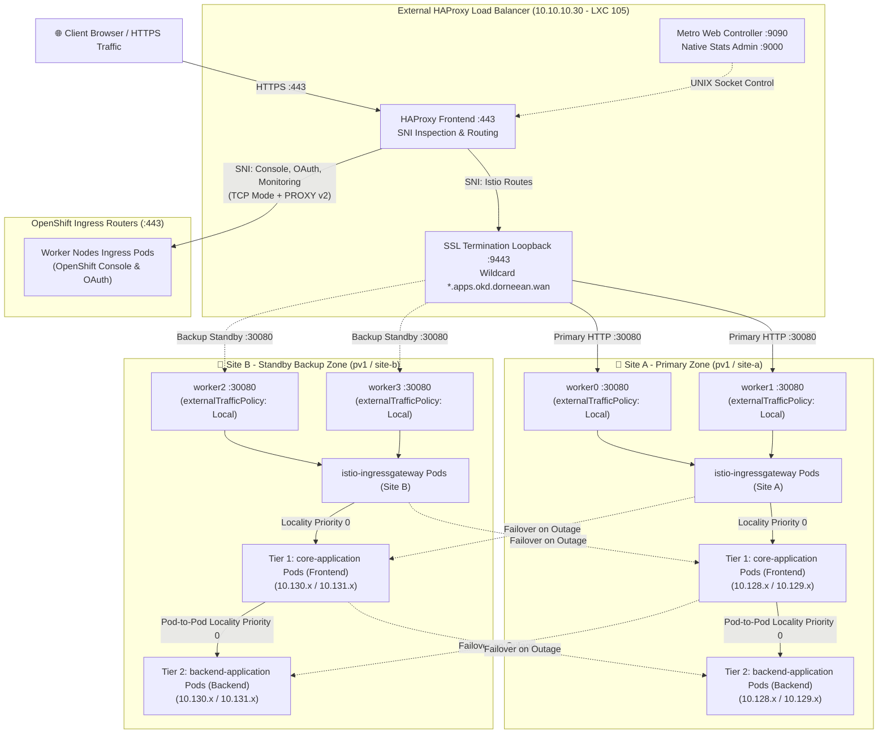

# OpenShift Metro Stretch Cluster High Availability with Red Hat OpenShift Service Mesh & Dual-Site Ingress

## 1. Executive Summary & Objective

This project delivers an enterprise-grade, active-active high-availability (HA) architecture for a single **Red Hat OpenShift / OKD** cluster stretched across two metro datacenters (**Site A** and **Site B**) with low-latency interconnect ($<10\text{ ms}$ RTT).



---

### Key Architecture Highlights

1. **2-Tier Intra-Zone Pod-to-Pod Communication**:
   - **Tier 1 (Frontend `core-application`)**: Receives ingress requests from `istio-ingressgateway` in its local zone, extracts incoming tracing headers, and calls the backend service.
   - **Tier 2 (Backend `backend-application`)**: Receives internal mesh calls from the frontend, verifies intra-zone routing (`site-a` $\to$ `site-a`, `site-b` $\to$ `site-b`), and returns responder pod/node identity with sub-millisecond local latency.
2. **Zone A Primary Locality Preference (Active-Passive / Standby Failover)**:
   - **External HAProxy Load Balancer (LXC 105 `10.10.10.30`)**:
     - Configured with **Site A as Primary** (`okd4-worker-1`, `okd4-worker-2`) and **Site B as Standby Backup** (`okd4-worker-3`, `okd4-worker-4 backup`).
     - In normal operation, **100% of ingress traffic preferentially hits Zone A**.
     - If Zone A experiences node/power failure or is toggled to `MAINT` via the Web Controller, HAProxy **automatically fails over 100% of traffic to Zone B** with zero connection loss.
3. **SNI-Based Split Ingress & Service Mesh NodePort Routing**:
   - Inspects SNI on port `443` without breaking standard OpenShift platform traffic.
   - **OpenShift Native Platform Ingress**: OpenShift Web Console (`console-openshift-console.apps...`), OAuth (`oauth-openshift.apps...`), and monitoring are forwarded as raw TCP with PROXY protocol v2 (`send-proxy-v2`) directly to worker nodes on port `443`.
   - **Istio Service Mesh Ingress**: Istio canonical routes (`shared-edge-route-istio-system.apps...`, `*.mesh.apps...`, `*.istio.apps...`) are decrypted via local SSL termination loopback (`127.0.0.1:9443`) using `/etc/haproxy/certs/dorneean.pem` and forwarded directly to the `istio-ingressgateway` **NodePort `30080`**.
4. **Strict Node & Zone Locality (`externalTrafficPolicy: Local`)**:
   - `istio-ingressgateway` runs 1 pinned replica per worker node across all 4 worker nodes with `externalTrafficPolicy: Local`.
   - When HAProxy directs traffic to `worker0` / `worker1` (Site A), the packet is processed strictly by the local Istio Ingress Gateway on Site A with zero inter-node or inter-site hops.
5. **Subzone Locality Load Balancing**:
   - Workloads are spread 50/50 across `site-a` and `site-b` using `topologySpreadConstraints`.
   - Istio `DestinationRule` with `localityLbSetting` (`topology.istio.io/subzone`) routes traffic to local pods within the same datacenter at both Ingress $\to$ Frontend and Frontend $\to$ Backend levels.
6. **Autonomous Zero-Touch Failover & Outlier Detection**:
   - Automatic cross-metro spillover to the surviving zone if a pod or node experiences consecutive 5xx errors or outages.
7. **Dedicated Storage Node Isolation**:
   - Storage nodes `okd4-storage-1..3` are dedicated strictly to Ceph/CSI storage and are excluded from HAProxy ingress load balancing.
8. **Interactive Management & Full Observability**:
   - Dedicated **HAProxy Metro Web Controller** for 1-click zone failover simulations.
   - **Kiali Console** and **Grafana Dashboards** integrated with OpenShift User Workload Monitoring.

---

## 2. Web Consoles & Endpoints

| Service | URL | Authentication | Description |
| :--- | :--- | :--- | :--- |
| **OpenShift Web Console** | [https://console-openshift-console.apps.okd.dorneean.wan](https://console-openshift-console.apps.okd.dorneean.wan) | OpenShift OAuth | OpenShift Cluster Administration & Workload Console |
| **HAProxy Metro Web Controller** | [http://10.10.10.30:9090](http://10.10.10.30:9090) | Open | Interactive Web UI to Enable, Disable (MAINT), Drain Site A & Site B nodes with 1-click controls |
| **HAProxy Native Stats Admin** | [http://10.10.10.30:9000](http://10.10.10.30:9000) | Open (Admin Mode) | Built-in HAProxy admin tabular interface with server actions |
| **Kiali Service Mesh Console** | [https://kiali-istio-system.apps.okd.dorneean.wan](https://kiali-istio-system.apps.okd.dorneean.wan) | OpenShift OAuth | Service mesh visual topology, live traffic animation, mTLS status |
| **Grafana Monitoring** | [https://grafana-istio-system.apps.okd.dorneean.wan](https://grafana-istio-system.apps.okd.dorneean.wan) | Anonymous / OpenShift | Istio performance metrics, RPS, latency & error dashboards |
| **Application Ingress Route** | [https://shared-edge-route-istio-system.apps.okd.dorneean.wan](https://shared-edge-route-istio-system.apps.okd.dorneean.wan) | Open | Service Mesh application route (NodePort :30080 via HAProxy) |

---

## 3. Cluster Topology & Node Architecture

### Node Topology Mapping

| Node | Proxmox Zone | Subzone (`topology.istio.io/subzone`) | Ingress Ports | Pod CIDR Range | Metro Role & Description |
| :--- | :--- | :--- | :--- | :--- | :--- |
| **`master0`** | `pv1` | - | `:6443`, `:22623` | `10.128.0.0/23` | Control Plane (etcd member 1, API server) |
| **`master1`** | `pv1` | - | `:6443`, `:22623` | `10.129.0.0/23` | Control Plane (etcd member 2, API server) |
| **`master2`** | `pv1` | - | `:6443`, `:22623` | `10.130.0.0/23` | Control Plane (etcd member 3, API server) |
| **`worker0`** | `pv1` | **`site-a`** | `:80`, `:443`, `:30080` | `10.128.2.0/23` | **Site A Primary Worker** (Router + IngressGateway + Workloads) |
| **`worker1`** | `pv1` | **`site-a`** | `:80`, `:443`, `:30080` | `10.129.2.0/23` | **Site A Primary Worker** (Router + IngressGateway + Workloads) |
| **`worker2`** | `pv1` | **`site-b`** | `:80`, `:443`, `:30080` | `10.130.2.0/23` | **Site B Standby / Survivor** (Router + IngressGateway + Workloads) |
| **`worker3`** | `pv1` | **`site-b`** | `:80`, `:443`, `:30080` | `10.131.0.0/23` | **Site B Standby / Survivor** (Router + IngressGateway + Workloads) |

> [!NOTE]
> **Proxmox CSI Storage Compatibility**: All nodes intentionally share `topology.kubernetes.io/zone=pv1` to maintain a single unified storage pool for the Proxmox CSI driver (Ceph/RBD). Physical metro datacenter separation is defined cleanly using the standard Istio topology label `topology.istio.io/subzone` (`site-a` vs. `site-b`). Storage nodes `okd4-storage-1..3` are dedicated exclusively to storage operations and are excluded from HAProxy ingress traffic balancing.

---

## 4. Ingress Architecture: IngressController vs. Service Mesh Ingress

To ensure both platform resilience and strict locality routing, the cluster separates **Native Platform Ingress** from **Service Mesh Application Ingress**:

```
                                    ┌──> [Port 443] OpenShift Router (HostNetwork) ──> Web Console / OAuth
Client ──> HAProxy :443 (SNI Split) ┤
                                    └──> [Port 9443 SSL Term] ──> [NodePort 30080] Istio Gateway (Local) ──> App Pods
```

### A. OpenShift Native IngressController (`openshift-ingress-operator`)
The default OpenShift router handles platform routes and services:
- **Configuration**: `spec.endpointPublishingStrategy.type: HostNetwork` with `protocol: PROXY` on ports `80` and `443`.
- **Replicas**: 4 replicas (`router-default-...`), scheduled 1 per worker node.
- **Traffic Handled**: OpenShift Web Console (`console-openshift-console.apps...`), OAuth (`oauth-openshift.apps...`), User Workload Monitoring, and Kiali/Grafana consoles.
- **HAProxy Integration**: HAProxy frontend `:443` passes non-Istio SNI requests directly to worker nodes on port `443` using `send-proxy-v2` in TCP mode.

### B. Istio IngressGateway (`istio-ingressgateway`)
Dedicated ingress gateway for service mesh applications:
- **Exposed via NodePort**: Port `80` $\to$ NodePort `30080`, Port `443` $\to$ NodePort `30443`.
- **`externalTrafficPolicy: Local`**: **Critical setting**. Prevents Kubernetes `kube-proxy` from load balancing NodePort traffic across worker nodes or across metro sites. Incoming packets arriving on `worker0`'s NodePort `30080` are handled *exclusively* by the `istio-ingressgateway` pod running locally on `worker0`.
- **Placement**: 4 replicas pinned 1 per worker node using `podAntiAffinity` (`kubernetes.io/hostname`).

### C. HAProxy SNI-Based Smart Ingress Routing (`10.10.10.30`)
HAProxy on LXC 105 performs Layer 4 SNI inspection on incoming port `443` connections:
- **Istio Application Matches**: SNI matching `shared-edge-route-istio-system.apps...`, `*.mesh.apps...`, or `*.istio.apps...` is routed to local loopback `127.0.0.1:9443`.
- **SSL Termination Loopback**: Terminates TLS with wildcard certificate `/etc/haproxy/certs/dorneean.pem` and forwards plain HTTP to `istio_http_ingress_traffic_be` (targeting worker NodePorts `30080`).
- **Platform Ingress Default**: All other SNI requests (Console, OAuth) bypass TLS termination and pass straight to worker nodes on port `443` with PROXY protocol v2.

---

## 5. How to Deploy Workloads Across Both Metro Zones

Follow this 4-step pattern to deploy any application with 50/50 dual-zone distribution, local-zone routing preference, and automated zero-downtime failover.

### Step 1: 50/50 Dual-Zone Pod Distribution (`topologySpreadConstraints`)

Configure `topologySpreadConstraints` in your `Deployment` spec to balance replicas evenly across `topology.istio.io/subzone`:

```yaml
apiVersion: apps/v1
kind: Deployment
metadata:
  name: my-app
  namespace: prod-apps
spec:
  replicas: 4
  selector:
    matchLabels:
      app: my-app
  template:
    metadata:
      labels:
        app: my-app
    spec:
      topologySpreadConstraints:
      # Spread evenly across metro subzones (site-a vs site-b)
      - maxSkew: 1
        topologyKey: topology.istio.io/subzone
        whenUnsatisfiable: ScheduleAnyway
        labelSelector:
          matchLabels:
            app: my-app
      # Spread across distinct worker nodes
      - maxSkew: 1
        topologyKey: kubernetes.io/hostname
        whenUnsatisfiable: ScheduleAnyway
        labelSelector:
          matchLabels:
            app: my-app
      containers:
      - name: app
        image: my-registry/my-app:latest
        ports:
        - containerPort: 8080
          name: http
```

### Step 2: Enable Istio Sidecar Injection

Ensure the namespace has Istio sidecar injection enabled:

```yaml
apiVersion: v1
kind: Namespace
metadata:
  name: prod-apps
  labels:
    istio-injection: enabled
```

### Step 3: Configure Locality Routing & Outlier Failover (`DestinationRule`)

Create a `DestinationRule` with `localityLbSetting` and `outlierDetection`:

```yaml
apiVersion: networking.istio.io/v1
kind: DestinationRule
metadata:
  name: my-app-locality-failover
  namespace: prod-apps
spec:
  host: my-app-svc.prod-apps.svc.cluster.local
  trafficPolicy:
    loadBalancer:
      localityLbSetting:
        enabled: true
        failoverPriority:
        - "topology.istio.io/subzone"
    outlierDetection:
      consecutive5xxErrors: 3
      interval: 5s
      baseEjectionTime: 30s
      maxEjectionPercent: 100
```

- **`failoverPriority`**: Tells Envoy to assign Priority 0 to pods with the matching `subzone` (`site-a` $\to$ `site-a`), and Priority 1 to the other zone (`site-b`).
- **`outlierDetection`**: If a pod returns 3 consecutive 5xx errors or fails health checks, Envoy automatically ejects it for 30s and routes traffic to surviving pods in the active/failover zone without dropped connections.

### Step 4: Expose via Shared Gateway (`VirtualService`)

Expose the frontend service through the shared ingress gateway:

```yaml
apiVersion: networking.istio.io/v1
kind: VirtualService
metadata:
  name: my-app-virtualservice
  namespace: prod-apps
spec:
  hosts:
  - "my-app.mesh.apps.okd.dorneean.wan"
  gateways:
  - istio-system/shared-gateway
  http:
  - match:
    - uri:
        prefix: /
    route:
    - destination:
        host: my-app-svc.prod-apps.svc.cluster.local
        port:
          number: 8080
```

### Step 5: 2-Tier Pod-to-Pod Locality Pattern (Frontend ➔ Backend)

To test and enforce strict intra-zone communication between dependent microservices:

1. Deploy the **Backend Workload** (`backend-application`) with its own `Service` (`backend-app-svc`) and `DestinationRule` (`backend-app-locality-failover`) containing `localityLbSetting` with `failoverPriority: ["topology.istio.io/subzone"]`.
2. Configure the **Frontend Workload** to call `http://backend-app-svc.prod-apps.svc.cluster.local:8080/` and propagate distributed tracing headers:
   - `x-request-id`, `x-b3-traceid`, `x-b3-spanid`, `x-b3-parentspanid`, `x-b3-sampled`, `x-b3-flags`, `x-ot-span-context`, `traceparent`, `tracestate`, `baggage`.
3. The Envoy sidecar on the Frontend pod evaluates the DestinationRule and automatically forwards the request to a Backend pod in the **exact same subzone** (`site-a` $\to$ `site-a` or `site-b` $\to$ `site-b`).
4. Sample response displaying both tiers and locality verification:

```text
================================================================================
   🌐 2-TIER INTRA-ZONE POD-TO-POD SERVICE MESH COMMUNICATION REPORT
================================================================================
[TIER 1: FRONTEND CALLER (Ingress Routed)]
  • Pod Name    : core-application-7cb89bc87f-jhkw2
  • Worker Node : worker0
  • Subzone     : site-a (Primary Site A)
  • Pod IP      : 10.128.2.18

[TIER 2: BACKEND RESPONDER (Mesh Routed via Locality LB)]
  • Pod Name    : backend-application-7445675c69-cmgzw
  • Worker Node : worker1
  • Subzone     : site-a (Primary Site A)
  • Pod IP      : 10.129.2.20
  • Internal RTT: 5.58 ms

[POD-TO-POD ZONE LOCALITY VERIFICATION]
  • Status      : ✅ SAME-ZONE INTRA-METRO ROUTING (site-a ➔ site-a)
  • Locality LB : Priority 0 (Local Zone Traffic Preferred - Zero Inter-DC Cross Traffic)
================================================================================
```

---

## 6. Manifest Directory

All manifests are located in [`openshift-service-mesh/`](file:///Volumes/eXaData/HOME/openshift-service-mesh):

- [**`01-servicemesh-subscription.yaml`**](./01-servicemesh-subscription.yaml): Red Hat OpenShift Service Mesh 3.x Operator.
- [**`02-istio-cni.yaml`**](./02-istio-cni.yaml): `IstioCNI` DaemonSet across all nodes.
- [**`03-istio-controlplane.yaml`**](./03-istio-controlplane.yaml): `istiod` Control Plane (`meshID: metro-mesh`).
- [**`04-istio-ingressgateway.yaml`**](./04-istio-ingressgateway.yaml): Ingress Gateway Service (`type: NodePort`, `30080`/`30443`, `externalTrafficPolicy: Local`) and 4-replica Deployment with `podAntiAffinity`.
- [**`05-sample-metro-app.yaml`**](./05-sample-metro-app.yaml): 2-Tier Workload deployment (`core-application` frontend & `backend-application` backend) with metadata reflection, HTTP tracing propagation, `VirtualService`, and Subzone Locality `DestinationRules` for intra-zone pod-to-pod mesh routing.
- [**`06-kiali-operator.yaml`**](./06-kiali-operator.yaml): Red Hat OpenShift Service Mesh Kiali Operator subscription.
- [**`07-kiali-cr.yaml`**](./07-kiali-cr.yaml): Kiali instance with OpenShift OAuth & Grafana integration.
- [**`08-enable-user-workload-monitoring.yaml`**](./08-enable-user-workload-monitoring.yaml): OpenShift cluster monitoring config for user workload scraping.
- [**`09-istio-observability.yaml`**](./09-istio-observability.yaml): Istio `Telemetry` and Prometheus `PodMonitor` CRs.
- [**`10-grafana.yaml`**](./10-grafana.yaml): Dedicated Grafana deployment, Prometheus datasources, and OpenShift Route.
- [**`haproxy-webui/app.py`**](./haproxy-webui/app.py): HAProxy Web Controller daemon running on Proxmox LXC 105.
- [**`haproxy-webui/haproxy.cfg`**](./haproxy-webui/haproxy.cfg): Full HAProxy production configuration with SNI routing, SSL termination, and sub-second health checks.
- [**`test-connectivity.sh`**](./test-connectivity.sh): **Non-disruptive continuous health and traffic inspector** (runs indefinitely until Ctrl+C).
- [**`test-failover.sh`**](./test-failover.sh): Standard software failover test runner (cordoning/draining).
- [**`hard-test.sh`**](./hard-test.sh): **Hard disaster test runner** simulating simultaneous worker node reboot with high-volume traffic stream validation.

---

## 7. Testing & Validation Suites

### A. Non-Disruptive Connectivity & Continuous Health Inspector
Streams live requests indefinitely with real-time response time, pod name, IP address, and site identification. Press `Ctrl+C` at any time to display the summary report.

```bash
# Continuous real-time probing (runs indefinitely until Ctrl+C)
./openshift-service-mesh/test-connectivity.sh

# Run with custom polling interval (e.g. 0.05s)
./openshift-service-mesh/test-connectivity.sh 0.05

# Run a fixed number of probes (e.g. 50 probes)
./openshift-service-mesh/test-connectivity.sh 50 0.05
```

### B. Standard Failover Simulation (Pod / Node Cordoning)
Simulates a Site A outage by cordoning `worker0`/`worker1` and deleting Site A pods, validating 100% absorption by Site B, followed by automated recovery.

```bash
./openshift-service-mesh/test-failover.sh
```

### C. Hard Disaster Simulation (Reboot Site A Workers & High-Volume Traffic Test)
Simulates a hard hardware outage by triggering simultaneous reboots on Site A worker nodes (`worker0` & `worker1`), while streaming 200+ continuous traffic probes through surviving Site B nodes.

```bash
./openshift-service-mesh/hard-test.sh
```

---

## 8. HAProxy Metro Web Controller (`LXC 105`)

The HAProxy Web Controller runs as a native systemd daemon (`haproxy-webui.service`) inside **Proxmox LXC 105** (`10.10.10.30`):

### Features
- **1-Click Zone Actions**:
  - 🔴 **"Disable Site A (Force Site B)"**: Disables `okd4-worker-1` and `okd4-worker-2` across HTTP, HTTPS, and Istio NodePort backends.
  - 🟡 **"Disable Site B"**: Disables `okd4-worker-3` and `okd4-worker-4`.
  - 🟢 **"Restore All Nodes (Active-Active)"**: Restores all 4 worker nodes to `READY`.
- **Per-Node Controls**: Toggle individual node states between `Ready`, `Disable (Maint)`, and `Drain`.
- **REST API Endpoints**:
  - `GET /api/stats`: Real-time session and backend metrics from HAProxy socket.
  - `POST /api/node/state`: Body: `{"node": "okd4-worker-1", "state": "maint|ready|drain"}`
  - `POST /api/site/action`: Body: `{"site": "site-a|site-b|all", "action": "maint|ready"}`
